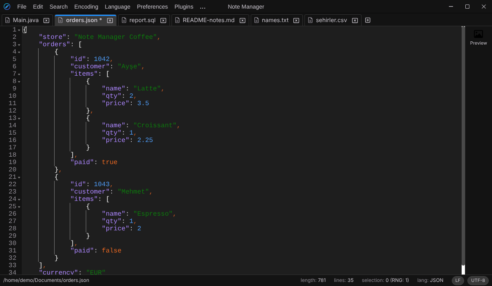
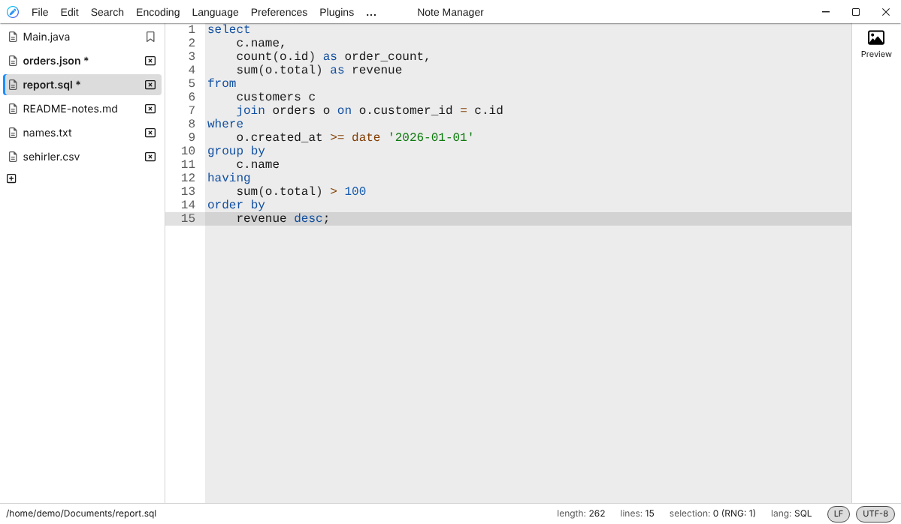
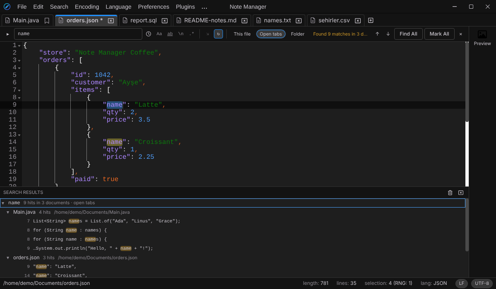
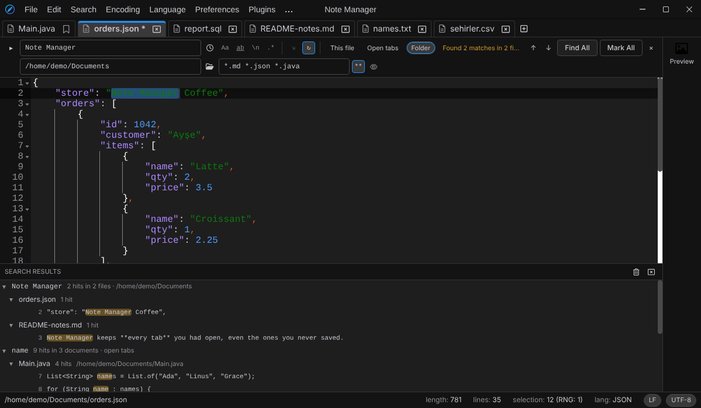
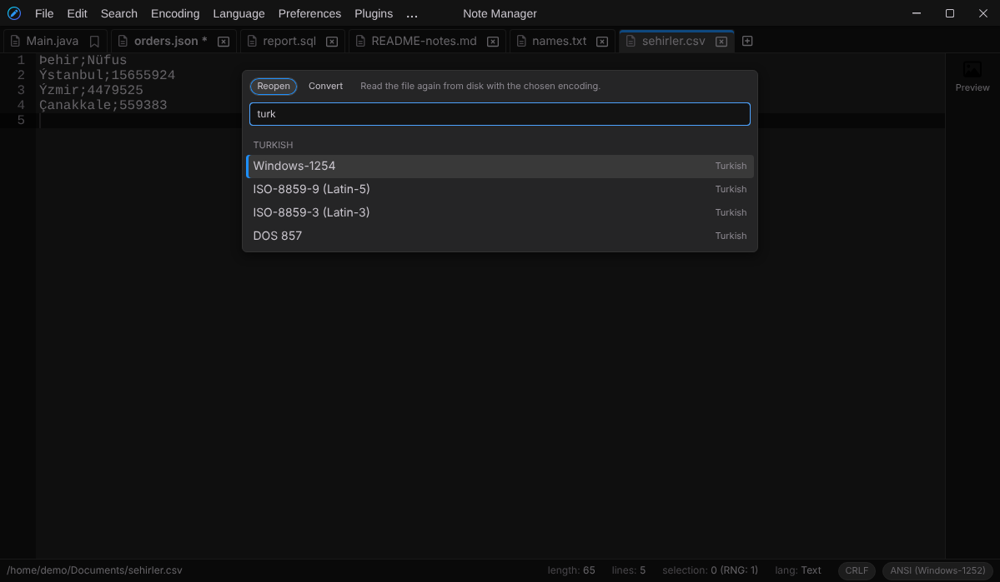
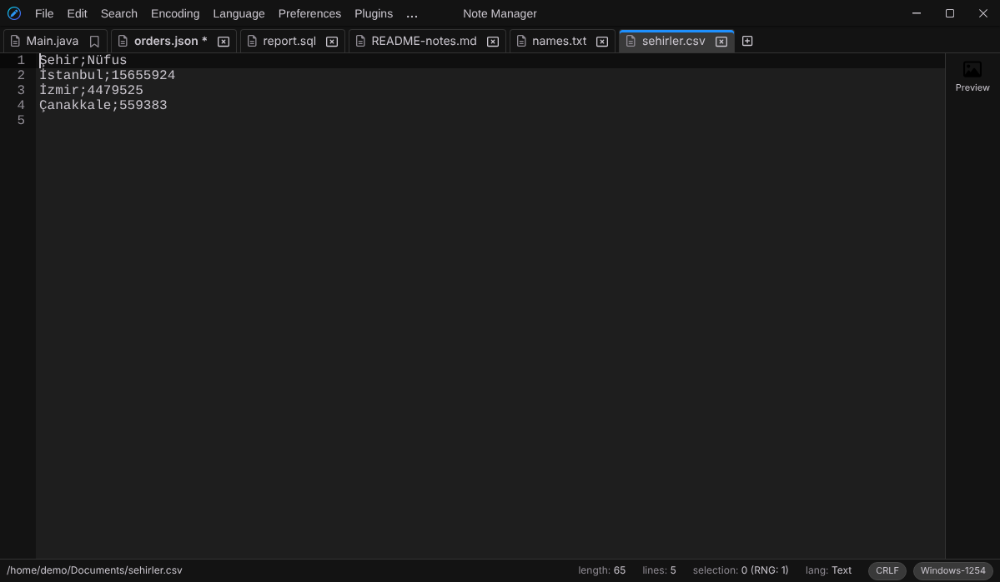
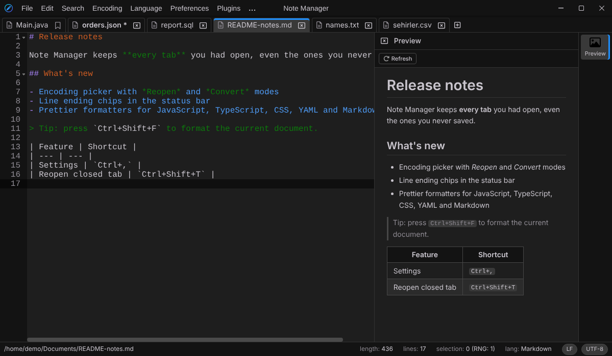
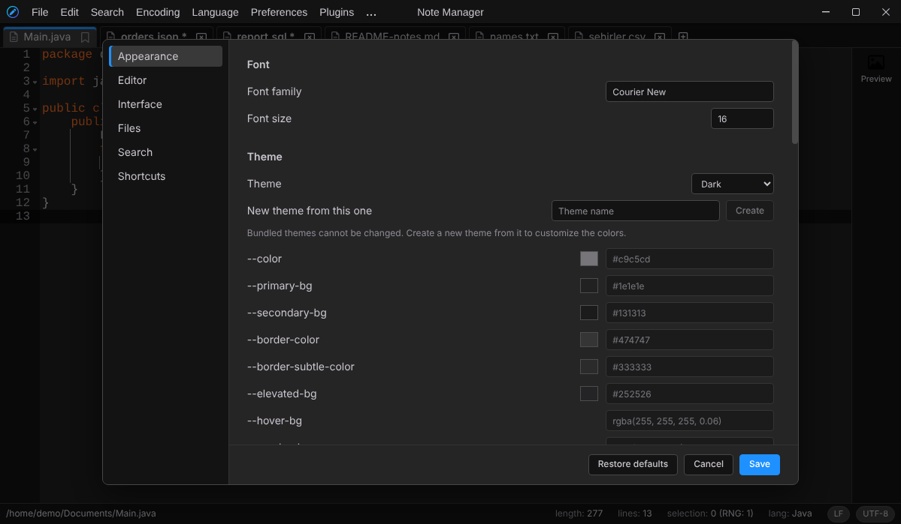
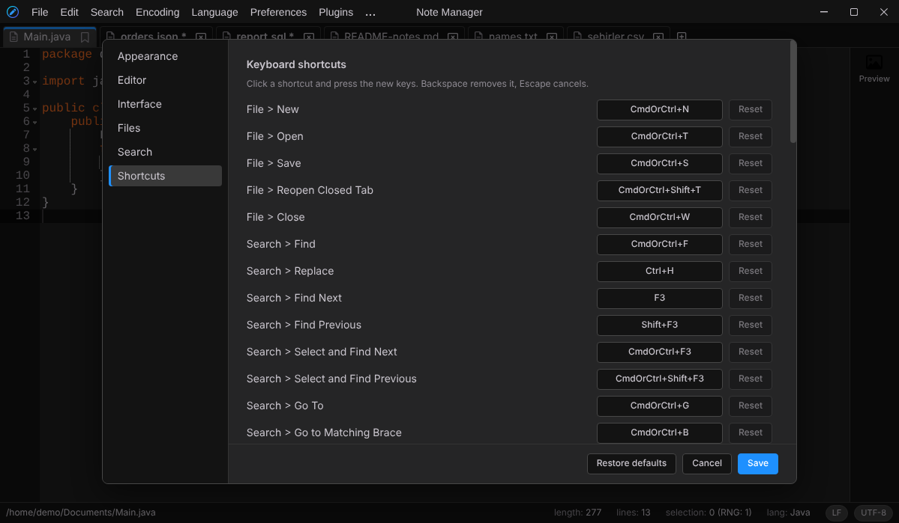

# Note Manager

[](https://github.com/Note-Manager/note-manager/actions/workflows/ci.yml)

A lightweight, fast and multi-functional desktop text editor for Windows, macOS and Linux. Note Manager is built with Electron, React and TypeScript on top of the [Ace](https://ace.c9.io/) editor. It is open source, and its code lives at [github.com/Note-Manager/note-manager](https://github.com/Note-Manager/note-manager).



## Contents

- [Features](#features)
- [Keyboard shortcuts](#keyboard-shortcuts)
- [Supported languages](#supported-languages)
- [Install from source](#install-from-source)
- [Getting started](#getting-started)
- [Building installers](#building-installers)
- [Development](#development)
- [Themes](#themes)
- [User plugins](#user-plugins)
- [Where data is stored](#where-data-is-stored)
- [Maintainers](#maintainers)
- [License](#license)

## Features

**Tabs and sessions**

- Your tabs, including unsaved content, cursor position, scroll position and undo history, are saved automatically and restored on the next start.
- Right-click a tab for Close, Close Other Tabs, Close Unmodified Tabs, Close All Tabs, Pin/Unpin, Open Containing Folder and Reopen Closed Tab.
- Right-click in the editor for Undo/Redo, Cut/Copy/Paste/Delete, Select All, Base64, Format, line and case tools, Find, Replace, Go To, Search on the Web, Markdown/HTML preview, Toggle Bookmark, Style Token / Clear Style, Open Containing Folder and Copy File Path. User plugin actions appear there too.
- Pinned tabs stay at the front and cannot be closed by accident.
- Drag tabs to reorder them.
- Reopen up to 20 recently closed tabs with their content.
- Choose a tab layout: a single scrolling row, wrapped rows, or a vertical list.
- Closing a changed tab or the window asks whether to Save, Don't Save or Cancel.
- Questions, warnings and errors appear in the app's own themed dialogs and notifications (bottom right), not in system message boxes. Escape cancels a dialog; errors stay until you dismiss them.



*The Light theme with tabs in a vertical list. The pinned tab stays at the top and shows a pin instead of a close button.*

**Files**

- Open files from the menu, by dropping them on the window, or with "Open with" from your file manager.
- File > Open Recent lists the last 10 files.
- File > Open Containing Folder shows the current file in your file manager.
- A warning is shown before opening very large (50 MB or more) or binary-looking files.
- Large documents stay responsive: heavy editor features are turned off for very large content.
- Only one instance runs at a time; files opened from a second launch go to the existing window.

**Search** (Search menu)

- Find (`Ctrl+F`) and Replace (`Ctrl+H`) open a search bar above the editor. It searches as you type, highlights every match and shows "3 of 12". Enter and Shift+Enter go to the next and previous match, Escape closes the bar.
- Options: match case, whole word (also for letters such as ş, ğ, ç), wrap around and search in selection (turned on by itself when you open the bar with a multi-line selection).
- Three modes: normal text, extended (`\n`, `\r`, `\t`, `\0`, `\xFF`, `\uFFFF`, `\d065`, `\o101`, `\b01000001`) and regular expressions, with an option to let `.` match line breaks. Matches may span lines, and `\n` matches any line ending.
- Replace supports `$1`, `\1`, `$<name>` and `$&` in regular expression mode and the escape sequences above in extended mode. Replace All in a document or a selection is a single undo step.
- The last 20 search and replace terms are kept: press Up/Down in the field or open the clock list.
- `F3` / `Shift+F3` find the next and previous match without opening the bar; `Ctrl+F3` / `Ctrl+Shift+F3` search for the selection or the word at the cursor.
- Find All (Alt+Enter in the search field) lists every match in a results panel at the bottom, either in this file or in all open tabs (pick "This file" or "Open tabs" in the bar). Each search stays in the panel, grouped by tab, with the line number and the matched text highlighted. Click a result or press Enter to jump to it, even in another tab; Up/Down, Left/Right (collapse/expand), Delete (remove a search) and Escape work in the panel. The panel can be resized and handles over a million results.
- `F4` / `Shift+F4` go to the next and previous result of the newest search, and `F7` shows or hides the panel.
- With "Open tabs" chosen, Replace All changes every open tab. Tabs in the background can be undone with `Ctrl+Z` when you switch to them.
- Find in Files (`Ctrl+Alt+F`, or "Folder" in the search bar) searches every file of a folder in the background. Pick the folder or type its path, add file filters such as `*.txt *.md !node_modules` (a `!` pattern skips matching files and folders), and choose whether to include subfolders and hidden files. Results arrive in the panel while the search runs and can be stopped. Each file is read with its own encoding, binary files are skipped, and clicking a result opens the file at the match.
- Replace All with "Folder" chosen asks first, then changes the files on disk and keeps each file's encoding and line endings. Files that are open in tabs are changed in the editor instead, so the change can still be undone. A file whose encoding cannot hold the replacement is left alone and listed in a notice.
- Go To (`Ctrl+G`) jumps to a line (`120`), a line and column (`120:15`) or a character offset (`#3456`). Go to Matching Brace is `Ctrl+B`.
- Search on the Web opens the selection in your browser; the search address is set in Settings > Search.
- Mark All (in the search bar or the Search menu) highlights every match of the search in the current file and keeps the highlight after the bar is closed; Clear Marks removes it. "Mark All and Bookmark Lines" also bookmarks each matching line.
- Style Token colors every occurrence of the selection, or the word at the cursor, in one of five styles (Search > Style Token, or right-click). Clear Style removes one style or all of them. Marks and styles follow your edits and are kept with the tab.
- Bookmarks: `Ctrl+F2` toggles a bookmark on the current line, `F2` / `Shift+F2` go to the next and previous bookmark. Search > Bookmark can also clear or invert them and cut, copy or remove the bookmarked (or the other) lines in a single undo step. Bookmarks move with the text and are kept with the tab.
- Smart highlighting: select a whole word (for example with a double-click) and its other occurrences are highlighted. It can be turned off in Settings > Search.

| Find All in open tabs | Find in Files |
| --- | --- |
|  |  |

**Encoding and line endings**

- Files are opened with the right encoding: the BOM first, then UTF-8, then a guess of the character set, and the system code page (ANSI) as the last resort.
- The status bar always shows the line ending (CRLF, LF or CR) and the encoding of the current document. Click the encoding to open the encoding picker, or the line ending to switch it.
- The encoding picker has two modes: **Reopen** reads the file again with the chosen encoding, **Convert** keeps the text and saves it with the chosen encoding. Type to search (for example `1254`, `latin 5` or `cyrillic`), use the arrow keys and Enter, and press Tab to switch modes. It lists UTF-8, UTF-8 with BOM, UTF-16 LE/BE, ANSI and nearly 50 regional character sets.
- The Encoding menu opens the picker in either mode, detects the encoding again, and switches line endings.
- Characters that the target encoding cannot hold are listed before a conversion or a save, so nothing is lost silently.
- Settings > Files sets the line ending and encoding of new files, whether encodings are guessed, and whether plain ASCII files count as UTF-8.

| Pick an encoding | The file read again as Windows-1254 |
| --- | --- |
|  |  |

**Editing tools** (Plugins menu)

- **Format**: JSON, XML, HTML, SQL, PL/SQL, JavaScript, TypeScript, CSS, YAML, Markdown and Java (powered by Prettier and dedicated formatters). Formats the selections, or the whole document when nothing is selected.
- **Lines**: sort ascending or descending (natural order), reverse, remove duplicates, remove empty lines, trim trailing whitespace.
- **Case**: UPPERCASE, lowercase, Title Case.
- **Base64**: encode and decode the selection.
- **Preview**: a sanitized preview for HTML and Markdown. Markdown is rendered GitHub style (tables, task lists, alerts such as `> [!NOTE]`, heading links and highlighted code blocks) in the colors of the current theme, and it follows your edits as you type. Relative images are loaded from the file's folder. Drag the edge between the editor and a tool window such as the preview to change its width (double-click resets it).



**Customization**

- A settings page (Preferences > Settings, `Ctrl+,`) for font, font size, word wrap, soft tabs, tab size, invisible characters, line numbers, tab layout, starting maximized, file encoding defaults and the web search address.
- Every menu shortcut can be changed or removed, with conflict detection.
- Five bundled themes (Dark, Light, Matrix, Orange Dark, Soft Light), plus your own themes whose colors you can edit from the settings page.
- Your own plugins, written in plain JavaScript (see [User plugins](#user-plugins)).

| Settings | Shortcuts |
| --- | --- |
|  |  |

## Keyboard shortcuts

On macOS, use `Cmd` instead of `Ctrl`. All of these can be changed in Settings > Shortcuts.

| Action | Shortcut |
| --- | --- |
| New tab | `Ctrl+N` |
| Open file | `Ctrl+T` |
| Save | `Ctrl+S` |
| Close tab | `Ctrl+W` |
| Reopen closed tab | `Ctrl+Shift+T` |
| Settings | `Ctrl+,` |
| Find / Replace | `Ctrl+F` / `Ctrl+H` |
| Find next / previous | `F3` / `Shift+F3` |
| Select and find next / previous | `Ctrl+F3` / `Ctrl+Shift+F3` |
| Find in files | `Ctrl+Alt+F` (`Cmd+Alt+Shift+F` on macOS) |
| Next / previous search result | `F4` / `Shift+F4` |
| Show or hide search results | `F7` |
| Toggle bookmark | `Ctrl+F2` |
| Next / previous bookmark | `F2` / `Shift+F2` |
| Go to line, column or offset | `Ctrl+G` |
| Go to matching brace | `Ctrl+B` |
| Format | `Ctrl+Shift+F` |
| Sort lines ascending | `Ctrl+Alt+Shift+S` |
| Base64 encode | `Ctrl+Alt+Shift+E` |
| Base64 decode | `Ctrl+Alt+Shift+D` |

The usual editing shortcuts of Ace (multiple cursors, moving and duplicating lines, and so on) also work.

## Supported languages

Syntax highlighting is chosen from the file name or extension, and can be changed from the Language menu, which keeps Text at the top and lists the other languages alphabetically, with languages that share a first letter grouped under that letter:

Plain text, JavaScript, TypeScript, JSON, XML, HTML, CSS, YAML, Markdown, Java, Kotlin, C/C++, C#, Go, Rust, Python, Ruby, PHP, SQL, PL/SQL, Shell, Batch, PowerShell, INI, Properties, TOML, Dockerfile and Makefile.

## Install from source

The `install/` folder has a script per operating system that builds Note Manager from this repository and installs it. Each script checks for Git and Node.js 22.17+ or 24+, runs `npm ci` and builds a clean `out/` folder, installs the result over any earlier installation and starts the app. Close Note Manager before running one.

| System | Script | What it installs |
|---|---|---|
| Windows | `install\install-windows.bat` (or `install\install-windows.ps1`) | Builds the Squirrel installer with `npm run make` and runs it, which installs the app for the current user |
| macOS | `install/install-macos.sh` | Builds the DMG and ZIP with `npm run make` and copies `Note Manager.app` into `/Applications` (or `~/Applications` when `/Applications` is not writable) |
| Linux | `install/install-linux.sh` | On Debian and Ubuntu, builds the DEB package with `npm run make` and installs it with `apt` (installing `fakeroot` first when it is missing). On other distributions, builds the app with `npm run package` and installs it for the current user in `~/.local/share/note-manager`, with `~/.local/bin/note-manager` and a desktop entry |

`install/linux_clean_install.sh` is kept for existing users and runs `install-linux.sh`.

From a clone, run the script for your system:

```bash
git clone https://github.com/Note-Manager/note-manager
cd note-manager
./install/install-linux.sh      # or ./install/install-macos.sh
```

```bat
git clone https://github.com/Note-Manager/note-manager
cd note-manager
install\install-windows.bat
```

A script can also be downloaded on its own. It then clones the repository into `~/note-manager` (`%USERPROFILE%\note-manager` on Windows), or updates that clone when it already exists, and builds it:

```bash
curl -fsSL https://raw.githubusercontent.com/Note-Manager/note-manager/main/install/install-linux.sh | bash
curl -fsSL https://raw.githubusercontent.com/Note-Manager/note-manager/main/install/install-macos.sh | bash
```

```powershell
Invoke-WebRequest https://raw.githubusercontent.com/Note-Manager/note-manager/main/install/install-windows.ps1 -OutFile install-windows.ps1
powershell -ExecutionPolicy Bypass -File .\install-windows.ps1
```

Options:

| Shell scripts | PowerShell | Meaning |
|---|---|---|
| `--dir <folder>` | `-Dir <folder>` | Where to clone the repository when the script is not run from a clone (default `~/note-manager`) |
| `--ref <branch-or-tag>` | `-Ref <branch-or-tag>` | Branch or tag to build (default `main` for a clone the script made; a clone the script runs from keeps its current branch) |
| `--help` | `-Help` | Show the usage |

Options go after `bash -s --` when the script is piped, for example `curl -fsSL <script url> | bash -s -- --ref main`.

## Getting started

Prerequisites:

- [Node.js](https://nodejs.org/) 22.17 or newer, or 24 and newer (Node 22 LTS is recommended; CI uses Node 22)
- npm 10 or newer
- Git

```bash
git clone https://github.com/Note-Manager/note-manager
cd note-manager
npm ci
npm start
```

`npm start` runs the app in development mode with hot reload for the user interface.

## Building installers

```bash
npm run package   # packaged app in out/
npm run make      # installers in out/make/
```

`npm run make` builds the installers for the current platform: a Squirrel installer on Windows, DMG and ZIP on macOS, and a DEB package on Linux. To build and install in one step, use the scripts in [`install/`](#install-from-source).

Windows installers are also built by the "Build Windows Installer" workflow on every push to `main`, and a macOS build can be started manually from the "Build and Package Note Manager" workflow.

## Development

| Command | What it does |
| --- | --- |
| `npm start` | Run the app in development mode |
| `npm run lint` | Run ESLint |
| `npm run typecheck` | Run the TypeScript compiler without emitting files |
| `npm test` | Run the unit tests with Vitest |
| `npm run package` | Package the app |
| `npm run make` | Build installers |

The CI workflow runs lint, type check and tests on every push and pull request.

Project layout:

```
src/
  main.ts            main process: window, menus, file access, settings
  preload.js         safe bridge between the window and the main process
  ipc/               main process event handlers
  utils/             menus, files, settings, themes, recent files, user plugins
  domain/            shared types (tabs, settings, languages, editor wrapper)
  react/             user interface (tabs, editor, settings page)
    components/editor/plugins/   bundled plugins
resources/
  Themes/            bundled themes
  Icons/             app icons
```

The user interface has no direct access to Node.js or the file system. Everything that needs it goes through the main process over IPC, and the window runs with context isolation and a Content Security Policy.

## Themes

A theme is a CSS file that sets variables on `:root`, for example:

```css
:root {
    --color: #c9c5cd;
    --primary-bg: #1e1e1e;
    --secondary-bg: #131313;
    --keyword-color: #ea6822;
    --string-color: #0d7a0d;
}
```

See `resources/Themes/Dark.css` for the full list of variables. To make your own theme, use "New theme" in Settings > Appearance, which copies an existing theme, then edit its colors there. You can also put CSS files in the themes folder yourself (Preferences > Theme > Open Themes Folder) and use Preferences > Theme > Reload Themes.

## User plugins

Note Manager loads plugins from the `Plugins` folder in its user data folder (Plugins > Open Plugins Folder). Each plugin is a folder with a `plugin.json` manifest and a script:

```
Plugins/
  upper-case/
    plugin.json
    plugin.js
```

`plugin.json` names the plugin and lists its actions. Action codes must look like `plugin.action` and must not reuse a code of another plugin. `accelerator` is optional and can be changed later in Settings > Shortcuts. `main` defaults to `plugin.js`.

```json
{
    "name": "Upper Case",
    "version": "1.0.0",
    "main": "plugin.js",
    "actions": [
        {"code": "upperCase.run", "label": "Upper Case Document", "accelerator": "CmdOrCtrl+Alt+U"}
    ]
}
```

The script registers the plugin. `doAction` receives the action code and the active editor; `initialize` is optional and runs whenever an editor is opened.

```js
noteManagerPlugins.register({
    initialize(editor) {
    },
    doAction(code, editor) {
        if (code === "upperCase.run") {
            editor.replaceRange(editor.getFullRange(), editor.getValue().toUpperCase());
        }
    }
});
```

The editor object provides `getValue`, `getSelectedText`, `getLanguage`, `getAllSelectionRanges`, `getSingleSelectionRange`, `getTextRange(range)`, `getFullRange`, `replaceRange(range, text)`, `replaceSelection(text)` and `replaceAllSelectionRanges(text)`.

The actions appear under the Plugins menu. After adding or changing a plugin, use Plugins > Reload User Plugins. Plugins whose manifest is invalid are skipped and the reason is written to the log.

User plugins run inside the editor window with the same access as the editor itself, so only install plugins you trust.

## Where data is stored

Note Manager keeps its data in the Electron user data folder:

- Windows: `%APPDATA%\Note Manager`
- macOS: `~/Library/Application Support/Note Manager`
- Linux: `~/.config/Note Manager`

| File or folder | Contents |
| --- | --- |
| `State.json` | Open tabs and their unsaved content |
| `preferences.json` | Settings, theme and shortcuts |
| `RecentFiles.json` | Recently opened files |
| `Themes/` | Your themes |
| `Plugins/` | Your plugins |

If `State.json` is damaged, it is kept as `State.json.corrupt` and the app starts with an empty session.

## Maintainers

- Taha Donuk ([@tdonuk](https://github.com/tdonuk))
- Hasan YILDIZ ([@hasanyildiz](https://github.com/hasanyildiz))

Bug reports, ideas and pull requests are welcome in the [issue tracker](https://github.com/Note-Manager/note-manager/issues).

## License

Note Manager is licensed under the Apache License 2.0. See [LICENSE](LICENSE).
